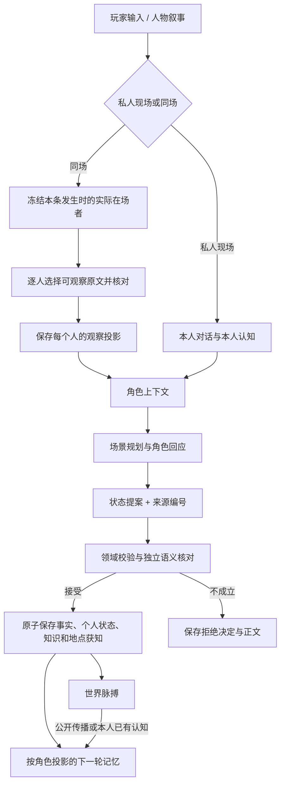

# 共界的信息传递链路

更新：2026-09-12。对应 Web 存储格式 17。

共享正史不等于共享输入。同一句叙事可能包含公开动作、定向耳语、纸条内容和人物心声；这些内容必须分别决定接收者。

## 逐段约束

| 环节 | 可以传递 | 不可以顺带传递 |
| --- | --- | --- |
| 私人入口 | 当前角色资料、自己的历史与获知版本 | 异地玩家的即时状态、其他角色的实时位置与私事 |
| 同场入口 | 实际在场者的公开身份 | 历史名单中已经离场的人 |
| 同场观察 | 该人看见或听见的逐字片段 | 未听见的耳语、未读的纸条、别人的心声 |
| 个人现场 | 自己的身体、情绪与未了处境 | 上一位发言者的个人线索和心理 |
| 事件获知 | 有来源的观察或转述内容 | 同一事件其他部分的客观详情、坐标、时刻 |
| 地点转告 | 原文中明确出现的称呼、唯一 ID 和本次说法 | 登记者的完整描述、未听到的正式名称或别名、路线和通行权 |
| 亲自抵达 | 本人实际到过该地点、此次抵达描写 | 房间全员自动同行、进入内门的资格 |
| 世界脉搏 | 公开传播、本人的私有认知、自己的承诺与意图 | 全世界的私人经历和秘密 |
| 摘要 | 保留来源与认知状态的所知版本 | 将误解、传闻重新写成客观事实 |

## 当前在场

`room_characters` 保留房间历史名单；`character_room_presence` 保存每个人唯一的当前同场。`player_scene_presence` 保存玩家当前私人入口或房间，同地点的两个入口也不能相互代替。

创建房间明确建立这次相聚，同时设置人物与玩家位置。私人入场、加入新房间、实际转场或脉搏离场清除旧身份。重开旧房间不召回人物；旧标签页不能绕过重新入场发送消息。

同场转场只移动当前发言者和玩家。旧房间及其他成员保持原处。已发布的到达正文即结束本轮房间分发，即使保存后的结算暂时等待恢复，也不会继续在旧现场安排玩家回应。后续旧房间结算不能依赖默认地点把玩家拉回。

## 观察与知识

`room_message_visibility` 保存消息发生时的接收者与逐人观察。未完成观察编译的内容不会直接作为全文交给角色。最新玩家输入绑定消息 ID；某人未听见这一条时输入为空，不能拿上一轮问话代替。

规划、角色正文、裁判及恢复均消费同一份观察。裁判可以引用观察片段，公开动作与秘密在同一句时也能分开登记；引用必须同时属于本轮原文和接收者的观察范围。

`character_knowledge` 保留来源账本，认知层只投影实际获知片段。误解优先保留本人信念，不附客观事实。旧同场知识再次读取时也按保存的观察限缩；尚未补齐观察的旧来源不开放。正史不被这项投影改写，合法的公开脉搏传播仍保留。

`room_personal_states` 分别保存每个角色的连续性。房间共享状态不再接受某个角色的私有心理与线索。

## 地点获知

事件发生地点描述“在哪里交谈”，不能代替“交谈介绍了哪里”。两者分别保存。

场景规划前，程序只从当前角色收到的玩家原文解析既有地点名称或别名。唯一匹配才提供对应 ID，内容仅包含此次转述；不存在的名称仍走受约束的地点创建流程。含糊名称不自动选取。只听到别名时，个人地点版本保留该称呼，不因为 ID 相同而附送登记的正式名称。

接受回合时，`location_mentions` 与其他变更同事务提交到地点的 `known_by / known_versions / knowledge_sources`。拒绝整轮时不会单独提交地点认知。只听说名字时 `route_known=false`，不能在自主脉搏中直接前往；实际抵达可以升级路线熟悉度，仍沿用本人所见，不开放别人的描述。

## 结算、恢复与存档

正文、提案与事实保持分离。所有硬状态都要通过领域和语义检查。模型将证据放在对应变化内部，场景层还原逐字来源并转换为统一领域格式；地点变化由已核对的抵达结论产生，事件时间继承本轮时钟，模型不重复填写。

与已确认基线完全相同的快照字段先由程序移除，空增量不再做模型审核。新增自由文本仍须检查来源与事实边界。审核返回的通过标志和问题列表必须一致，修复使用完整问题列表。

有限修复携带上一份原始提案及具体问题，逐项修改后重新完整校验；不会为了继续游戏把不成立的提案算成功。目的地正文通过后保持固定，提案失败只修提案，不重新生成角色答复。已有地点的用途与玩家授权统一在正文核对中检查，真正新增地点才单独核对设定。

观察投影、个人现场、在场身份、地点获知随世界检查点保存。格式 16 的存档统一升级到 17；成功结算的默认决定 `{}` 与拒绝决定区分处理。旧房间历史会建立待补观察记录，不把缺少观察数据当成全员可见。

模型负责判断语言含义，程序负责落实接收者、引用、ID、归属、事务与重试边界。语义核对仍可能拒绝一个含错误主张的回复；这与数据库写入故障分开处理，前者终结该提案并允许继续，后者保留可恢复任务。

## 实现入口

- 在场：`storage/presence.py`
- 同场观察编译：`scenes/observations.py`、`scenes/room_memory.py`
- 观察、个人现场及旧知识投影：`storage/information.py`
- 角色认知：`domain/knowledge.py`、`cognition/sync.py`
- 地点获知：`storage/location_knowledge.py`、`domain/locations.py`
- 原子写回与队列：`storage/store.py`、`scenes/settlements.py`
- 世界推进：`cognition/pulse.py`
